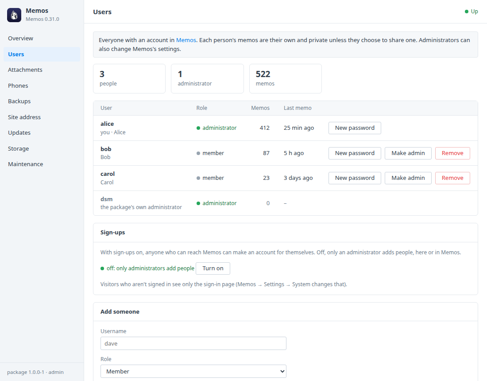
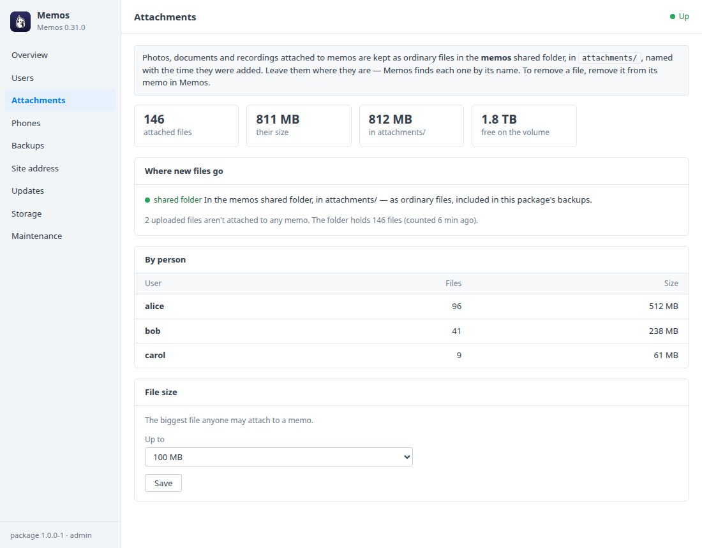
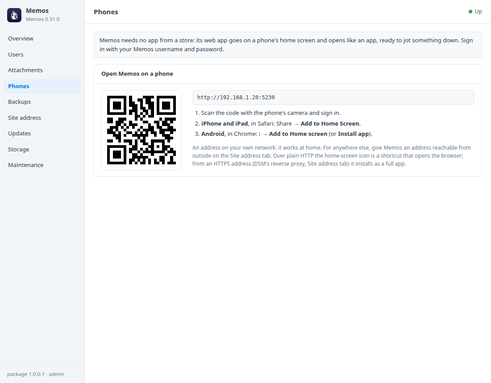
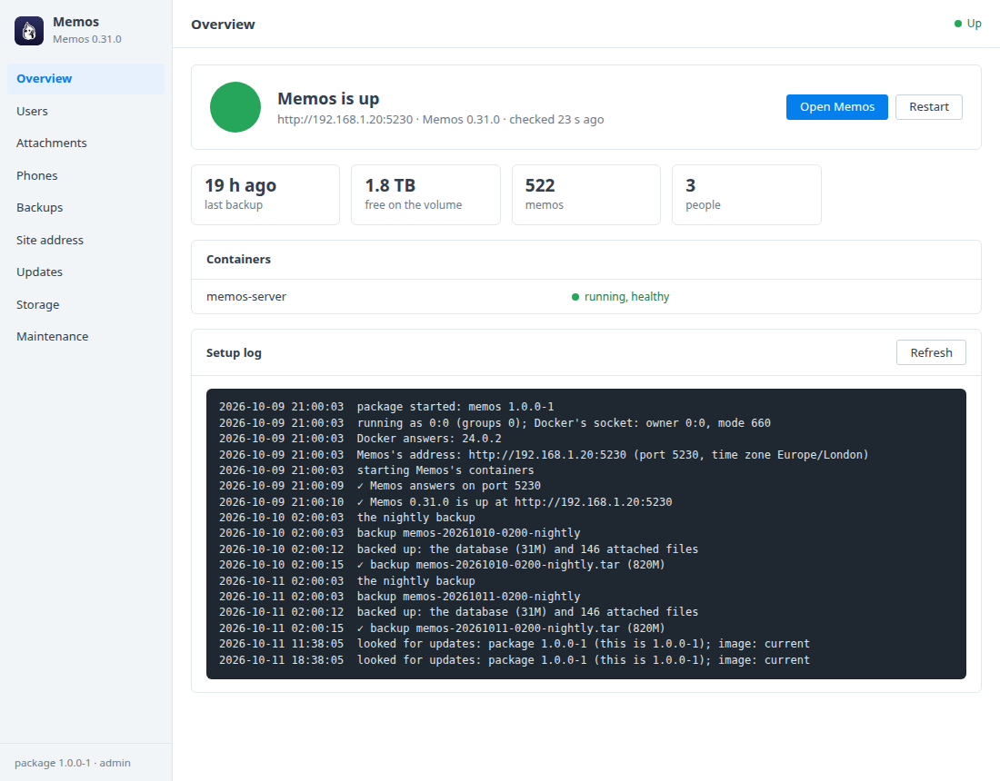

# Memos for Synology DSM

A DSM 7 package that installs [Memos](https://usememos.com) in Container
Manager. Memos is a place for quick private notes: thoughts, links, lists and
photos, jotted down in a second and found again by tag or search, from any
browser or phone. Your notes stay on your Synology, and the files you attach
are ordinary files in a shared folder. A DSM window looks after:
- the people who use it, their passwords and sign-ups;
- attached files, and how much room they take;
- putting Memos on a phone's home screen;
- backups and updates.

Built on the [DSM app chassis](https://github.com/tombruton87/dsm-app-chassis).

## Download

### **[⬇ Download memos.spk](https://github.com/tombruton87/memos-dsm/releases/latest/download/memos.spk)**

[](https://github.com/tombruton87/memos-dsm/releases/latest)

That link always gives the newest version. Older ones are on the
[Releases](https://github.com/tombruton87/memos-dsm/releases) page.

Install: Package Center → Manual Install → the `.spk` (DSM 7.2.1+; Container
Manager is installed first if missing). The wizard asks for the NAS's address,
a port (5230 by default), a time zone and your username. Your account is made
at the first start, as Memos's administrator, and its password is shown once
in the window.

**Sign-ups start off.** A fresh Memos lets anyone who can reach it make an
account. The package turns that off as soon as your account exists, so only an
administrator adds people. Turn it on in the window if you want it.

## What the DSM window adds

- **Users**
  - Everyone with an account: role, how many memos, and when they last wrote
    one.
  - **Add someone** as a member or an administrator; the password is made for
    them and shown once.
  - **New password** (shown once), **Make admin** / **Member only**, and
    **Remove** (with their memos and files). Your own account stays an
    administrator.
  - **Sign-ups** on or off.
- **Attachments**
  - Photos, documents and recordings attached to memos live in the *memos*
    shared folder, in `attachments/`, where File Station and Hyper Backup see
    them.
  - How many files there are and how much room they take, in all and by person.
  - Where Memos puts new files; a warning if that has been changed in Memos to
    its database or S3.
  - The biggest file anyone may attach (30 MB to 1 GB).
- **Phones** — a QR code of Memos's address, and how to add Memos to the home
  screen on iPhone and Android.
- **Site address** — the address people use, which Memos also uses in the
  links it makes.
- **Backups, updates, storage, maintenance** — a consistent copy of Memos's
  database (`sqlite3 .backup`) and every file in `attachments/`, made nightly
  or on demand, with restore. You can also:
  - update to newer Memos 0.31 images or a newer package from inside DSM;
  - make a redacted support report;
  - read the logs;
  - remove Memos and everything with it.

## Screenshots

| | |
|---|---|
|  |  |
|  |  |

## How it works

Memos (`neosmemo/memos`, pinned to 0.31) runs as one container. Its SQLite
database lives in the `memos_data` volume. Its "local" storage folder,
`assets/`, is the shared folder's `attachments/`, and Memos writes it as the
package's own user, so the files are yours to see and back up.

The window works through Memos's own API, as an administrator the package
makes for itself (`dsm`, with an access token kept in the root-only `.env`).
The window's numbers come from Memos's database, read read-only: Memos's API
only counts what the asker may see, and people's memos are private. Your
password is never stored.

A newer Memos than 0.31 comes with a package update, which moves the image
forward once the package knows that Memos's API.

## Layout

```
chassis/          the DSM app chassis (git submodule)
package.conf      name, title, services, volumes, images, port, texts
app/compose.yaml  Memos, with attachments/ from the shared folder
setup/app.sh      the hooks: your account, the package's administrator, the window's numbers, backups
ui/               Users, Attachments and Phones tabs; CGI validation
wizard/           the username page of the install wizard
tests/            steps for the chassis harness (memos and attachments through Memos's API, people, backup and restore)
```

Test: `chassis/tests/e2e.sh . up && chassis/tests/e2e.sh . act` on any Linux
box with Docker; `chassis/tests/test-api.sh <built target/ui> .` for the CGI.

Release: bump `VERSION`, add the changes to `CHANGELOG.md`, build, then attach
the package twice, under its versioned name and as `memos.spk`:

```bash
cp dist/memos-X.Y.Z-1.spk /tmp/memos.spk
gh release create vX.Y.Z dist/memos-X.Y.Z-1.spk /tmp/memos.spk
```

Build: `chassis/build.sh . N`.

## Credits

The icon is Memos's own cockatoo on a DSM-style tile in its navy. Memos is
MIT-licensed open-source software by its contributors. This package is not
affiliated with Memos or Synology.
